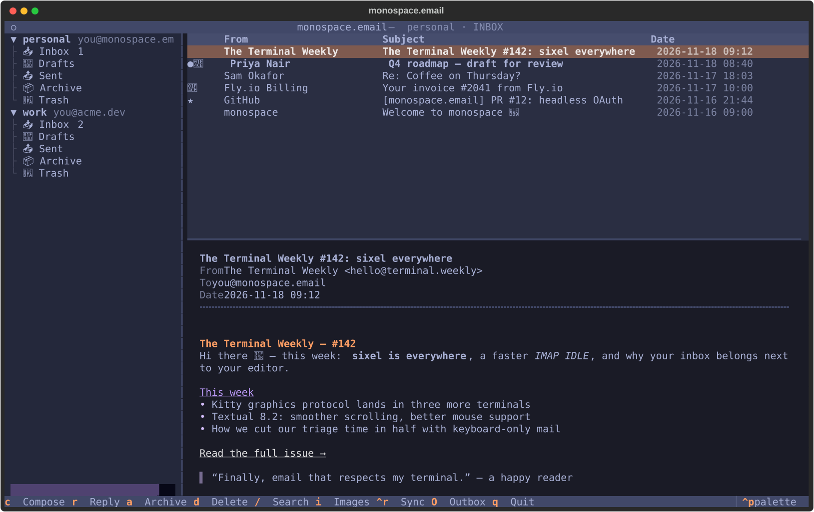
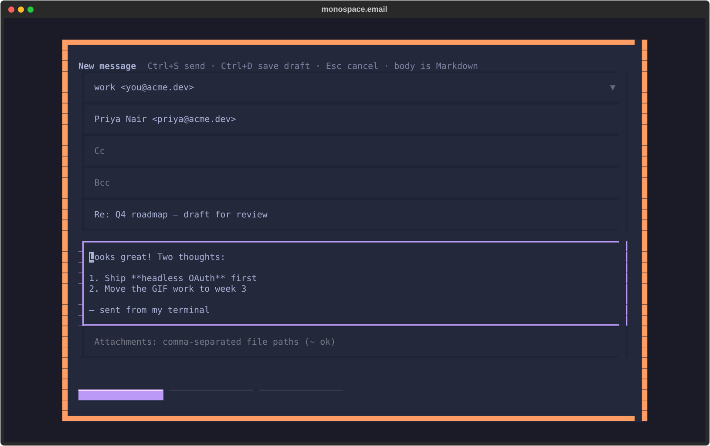

<div align="center">

# `monospace`<sub>.email</sub>

**Email in your terminal, with real images, animated GIFs, a mouse, and an AI you can trust with it.**

[](https://github.com/scaryshinyglasses/monospace.email/actions/workflows/ci.yml)


[](LICENSE)

**[Website ↗](https://monospace.arp244.dev)**

```sh
curl -fsSL https://monospace.arp244.dev/install.sh | sh
```



</div>

---

## Why monospace?

You probably keep a terminal open all day, and email is often the reason to leave it.
monospace aims to give you a mail client fast enough that you stop reaching for the browser:

<table>
<tr>
<td width="50%" valign="top">

### 📬 Every inbox
Gmail and Outlook / Microsoft 365 sign-in, plus **any** IMAP + SMTP server.
Several accounts appear in one tree.

### 🖼 Pictures, not placeholders
HTML mail renders as formatted text with **inline images and animated GIFs**:
- Kitty graphics and Sixel are detected automatically (Ghostty, Kitty, WezTerm, iTerm2, foot, Konsole…).
- Other terminals get coloured half-blocks.
- Remote images are **blocked by default**, which stops tracking pixels. Press `i` to load them.

### 🖱 Clickable *and* keyboard-first
Click folders, messages, links and attachments, or never touch the mouse:
vim keys, `/` search and one-key actions.

</td>
<td width="50%" valign="top">

### 🤖 AI-native, with guardrails
A built-in **MCP server** and a `--json` CLI let Claude, Codex (or any agent) triage,
search, draft and reply. You choose per account what an agent may do:

| `ai_send` | agent sends become… |
|---|---|
| `draft` *(default)* | a draft in your Drafts folder |
| `confirm` | a queued message you approve |
| `allow` | a sent email |

### 🖥 Headless first
It runs over SSH and on a bare Linux console:
- Gmail sign-in works without a browser.
- Secrets go to an encrypted file when there's no keyring.
- Copied links use OSC 52, so the clipboard works over SSH.
- ASCII icons are used on `TERM=linux`.
- `daemon --install` sets up systemd or launchd background sync.

### ⚡ Fast and offline
A local SQLite cache with full-text search, and new mail pushed over IMAP IDLE.

</td>
</tr>
</table>

<!-- release-notes:start -->
### What's new

**Unreleased**

- Generate release notes on every push; add a release workflow ([962c2cd](https://github.com/scaryshinyglasses/monospace.email/commit/962c2cd))
- Add tags for messages and drafts (TUI, CLI, MCP, search) ([ae74da8](https://github.com/scaryshinyglasses/monospace.email/commit/ae74da8))
- Serve installer from Monospace website URL ([733a6eb](https://github.com/scaryshinyglasses/monospace.email/commit/733a6eb))
- Create Monospace product website ([788593e](https://github.com/scaryshinyglasses/monospace.email/commit/788593e))
- Sanitizer review path: iterative render, fail closed on odd URLs ([64a995a](https://github.com/scaryshinyglasses/monospace.email/commit/64a995a))
- Compare HTML to text from the DOM with links tokenized in place ([fba7dc8](https://github.com/scaryshinyglasses/monospace.email/commit/fba7dc8))
- Allowlist file types agents may send from approved read dirs ([f075902](https://github.com/scaryshinyglasses/monospace.email/commit/f075902))
- Compare link targets as normalized URLs; restrict img alt text ([f42659a](https://github.com/scaryshinyglasses/monospace.email/commit/f42659a))

[Full changelog](CHANGELOG.md) · [Releases](https://github.com/scaryshinyglasses/monospace.email/releases)
<!-- release-notes:end -->

## Install

The one-liner works on **macOS and Linux** (x86_64 and arm64), including minimal servers with no
Python or git installed:

```sh
curl -fsSL https://monospace.arp244.dev/install.sh | sh
```

It installs [uv](https://docs.astral.sh/uv/) if you don't have it. uv then fetches its own Python, and
`monospace` lands in `~/.local/bin`.

<details>
<summary><b>Other ways to install, upgrade and uninstall</b></summary>

```sh
# with uv or pipx directly
uv tool install git+https://github.com/scaryshinyglasses/monospace.email
pipx install git+https://github.com/scaryshinyglasses/monospace.email

# a specific version
curl -fsSL https://monospace.arp244.dev/install.sh | MONOSPACE_REF=v0.1.0 sh

# upgrade: `monospace update` (or run the installer again);  uninstall (your config and mail cache are kept):
curl -fsSL https://monospace.arp244.dev/install.sh | sh -s -- --uninstall
```
</details>

## Quick start

```sh
monospace            # opens the client — the first run walks you through adding an account
monospace doctor     # checks keyring, terminal graphics and connectivity
monospace update     # installs the latest version (the app tells you when one exists)
```

<div align="center">

<br><sub>Compose in Markdown. It's sent as clean plain text plus HTML.</sub>
</div>

### Keys

| | | | |
|---|---|---|---|
| `j` `k` / ↑ ↓ | move | `Enter` / click | open |
| `c` | compose | `r` · `R` · `f` | reply · reply-all · forward |
| `a` | archive | `d` · `Del` · `#` | delete |
| `u` | toggle unread | `*` | toggle flag |
| `/` | search all mail | `Esc` | back |
| `i` | load remote images | `H` | HTML ↔ plain text |
| `Ctrl+R` · `g` | sync now | `O` | AI outbox |
| `A` | add account | `q` | quit |
| `e` | edit the selected draft | `N` · `E` · `X` | new · rename · delete folder |
| `t` | tag the message or draft | | |

In the composer, **Attachments** are files the recipient downloads and **Inline images** show in the body.
Write an inline image as `logo.png;width=120;position=top`, or place it yourself with ``.

In compose, `Ctrl+S` sends and `Ctrl+D` saves a draft.

### Tags

Press `t` to tag any message or draft (comma-separated, empty clears). Each account gets a **Tags** branch
in the folder tree, and `/` search understands `tag:work` and `tag:"big client"`. monospace uses the
server's own mechanism when there is one, so other clients see your tags too:

| Server | Tags are stored as |
|---|---|
| Gmail | **labels** (a new label also shows up as a folder, as it does in Gmail) |
| Fastmail, Dovecot, most self-hosted IMAP | **IMAP keywords** (ASCII, no spaces) |
| Outlook / Microsoft 365, others without keywords | **locally**, in monospace's cache only |

`monospace account set work tags=local` keeps one account's tags local. System names (Inbox, Spam, Starred,
`\Seen`, `$Junk` …) can't be used as tags, so tagging can never move or archive mail.

**Copy & paste:** select text with the mouse and press `Ctrl+C` (with nothing selected, `Ctrl+C` quits).
`Ctrl+V` pastes the system clipboard via `pbpaste` / `wl-paste` / `xclip` / `xsel` when a display is
available; your terminal's own paste (`Cmd+V`, `Ctrl+Shift+V`) always works. Copies go out over OSC 52
(wrapped for tmux/screen) plus the native tool, so they reach your local clipboard over SSH too. In tmux, set
`set -g set-clipboard on` and `set -g allow-passthrough on` in `~/.tmux.conf` (these are tmux commands, not shell
commands; apply them with `tmux source-file ~/.tmux.conf`).

**Images:** in Kitty, Ghostty, WezTerm, iTerm2, foot or Konsole, images draw at full resolution. Other terminals
(macOS Terminal.app, VS Code, most SSH setups without passthrough) get coloured half-blocks; images too small to
be legible that way (logos, avatars) stay as text labels. Pick a theme with `Ctrl+P` → *Theme*; it's remembered.

## Let your AI read your mail, safely

Works with **Claude Code**, **OpenAI Codex**, and any other MCP client that runs stdio servers:

```sh
monospace mcp install claude     # runs: claude mcp add --scope user monospace -- /abs/path/monospace mcp
monospace mcp install codex      # runs: codex mcp add monospace -- /abs/path/monospace mcp
monospace mcp install codex --print   # just show the command / config, change nothing
```

`install` calls the client's own `mcp add` with the **absolute path** to `monospace`, because AI clients
launch MCP servers with a minimal environment where `~/.local/bin` may not be on `PATH`.

<details>
<summary><b>Manual setup</b> (Codex <code>config.toml</code>, other clients)</summary>

Codex, in `~/.codex/config.toml` (find the path with `which monospace`):

```toml
[mcp_servers.monospace]
command = "/home/you/.local/bin/monospace"
args = ["mcp"]
```

Claude Code: `claude mcp add --scope user monospace -- "$(which monospace)" mcp`.
Any other client: run the command `monospace` with the argument `mcp` over stdio.

**Headless machines (encrypted secrets file):** AI clients don't pass your shell's environment through, so a
`MONOSPACE_PASSPHRASE` exported in `.bashrc` won't reach the server. Run `monospace` once and answer **y** to
*Remember it on this machine?*. Alternatively pass it explicitly (`codex mcp add --env MONOSPACE_PASSPHRASE=…`),
but that stores it in the client's config file in plain text.
</details>

Then ask: *"Summarise my unread mail and draft replies to anything from Priya."*

```
 you ──▶ Claude / Codex ──MCP──▶ monospace ──IMAP/SMTP──▶ your provider
                             │
                             └─ ai_send policy:  draft │ confirm ─▶ outbox (you approve, O / y) │ allow
```

**Tools:** `list_accounts` `sync` `list_folders` `list_messages` `search` `read_message`
`save_attachment` `send_email` `create_draft` `reply` `forward` `mark` `move` `outbox_list` `outbox_cancel`
· drafts: `get_draft` `update_draft` `send_draft` `delete_draft`
· folders: `create_folder` `rename_folder` `delete_folder` (empty, non-system only)
· tags: `tag_message` `untag_message` `list_tags`; `list_messages(tag=…)`, `search("tag:work")`

Compose tools take `cc`/`bcc`, a markdown `body` or a raw `html_body`, and two kinds of file:
**`attachments`** (downloadable files) and **`inline_images`** (shown inside the body, e.g. a logo).
An inline image is a path or `{path, alt, width, height, position: top|bottom, align, link}`. To place it
yourself, reference it as `` or ``. `update_draft` edits a saved
draft in place and keeps its existing attachments and images unless you remove them. `forward` can carry
the original's attachments.

**Guardrails built into the code, not into a prompt:**
- There's **no** tool to approve the outbox or change the policy. Those commands refuse to run without an interactive terminal.
- Agents can only attach or embed files from folders you control (shown by `list_accounts`): the agent-attachments
  folder, plus any you add with `monospace agent-dirs add ~/Documents/brand` (interactive only; `/`, your home
  folder and hidden folders like `~/.ssh` are refused). Everything else is rejected, including escapes through symlinks.
- Agent-written HTML is sanitized before it's sent: no CSS, scripts, remote images or hidden content. The outbox
  shows you exactly what recipients will see, with link targets spelled out.
- Attachments on queued messages are snapshotted, so the file you approve is the file that gets sent.
- Email bodies are handed to the model **marked as untrusted content**, which is a defence against prompt injection.

The CLI works the same way for scripts and agents:

```sh
monospace ls --unread --json
monospace read 42 --json
monospace search "invoice march"
echo "Sounds good — see you then." | monospace reply 42
monospace send --to bob@example.com --subject Hi --body "**Hello**" --attach ~/notes.pdf \
               --inline "logo.png;width=120;position=top"     # --html page.html to send your own HTML
monospace drafts ls                    # then: drafts show 12 · drafts edit 12 --subject … --inline logo.png
monospace drafts edit 12 --editor      # body in $EDITOR;  --detach / --remove-inline NAME drop parts
monospace drafts send 12               # · drafts rm 12
monospace forward 42 --to ana@example.com      # carries the attachments (--no-attachments to skip)
monospace folders create Receipts      # · folders rename A B · folders rm A (empty only)
monospace tag add 42 work "big client" # · tag rm 42 work · tag set 42 a,b · tag ls · tag show work
monospace ls --tag work                # or: monospace search "tag:work invoice"
monospace outbox list            # then: monospace outbox approve 7   (humans only)
```

## Accounts

| Provider | Out of the box | With your own OAuth app |
|---|---|---|
| **Gmail** | app password (needs 2-Step Verification) | Sign in with Google: browser, or paste-URL when headless |
| **Outlook / M365** | app password, where your tenant allows it | Microsoft device code: works anywhere |
| **Anything else** | IMAP + SMTP host, SSL / STARTTLS | — |

```sh
monospace account add                                   # interactive (or press A in the app)
monospace account add --provider gmail --no-browser     # on a server
monospace account set work ai_send=confirm
```

<details>
<summary><b>Set up Gmail OAuth (about 5 minutes)</b></summary>

1. In [Google Cloud Console](https://console.cloud.google.com/) create a project. Configure the **OAuth consent screen** (External), and add yourself as a test user.
2. Go to **Credentials → Create credentials → OAuth client ID → Desktop app**.
3. Run `monospace oauth --google-client-id <id> --google-client-secret <secret>`. A Desktop-app secret isn't confidential.

**Headless:** `monospace account add --no-browser` prints a link. Approve access on your phone or laptop, then paste back
the `http://localhost…` address the browser lands on. The page fails to load, and that's expected. Alternatively,
`ssh -L 8765:localhost:8765 server` together with `--listen` lets the loopback flow complete on its own.

> Apps in *Testing* status issue refresh tokens that expire after 7 days. Publish the app, or run `monospace account login <name>` again when the token expires.
</details>

<details>
<summary><b>Set up Outlook / Microsoft 365 OAuth</b></summary>

1. In Entra ID, go to **App registrations → New registration**. Under supported account types choose *any organizational directory and personal Microsoft accounts*.
2. Under **Authentication**, set *Allow public client flows* to **Yes**.
3. Under **API permissions**, add *Office 365 Exchange Online* → delegated `IMAP.AccessAsUser.All` and `SMTP.Send`.
4. Run `monospace oauth --microsoft-client-id <id>`. Add `--microsoft-tenant <tenant-id>` to restrict sign-in to one tenant.

Some tenants need an admin to enable SMTP AUTH for the mailbox.
</details>

## Runs anywhere

| | macOS | Linux desktop | Linux over SSH | Bare console (`TERM=linux`) |
|---|---|---|---|---|
| Images & GIFs | ✅ pixels | ✅ pixels | ✅ pixels, if your local terminal supports them | ✅ half-blocks |
| Mouse | ✅ | ✅ | ✅ | keyboard only |
| Secrets | Keychain | Secret Service | encrypted file | encrypted file |
| Gmail sign-in | browser | browser | paste-URL / `ssh -L` | paste-URL |
| Links | open in browser | open in browser | copied (OSC 52) | copied |
| Background sync | launchd | systemd `--user` | systemd `--user` | systemd `--user` |

On machines without a usable keyring (none installed, or one that's locked and can't prompt, as with GNOME Keyring over SSH), secrets live in `~/.local/share/monospace/secrets.enc` (Fernet + scrypt, mode `0600`),
unlocked by `MONOSPACE_PASSPHRASE` or a prompt. After the prompt you can choose to remember the passphrase on
that machine (`~/.local/share/monospace/passphrase`, mode `0600`; delete the file to forget it). That makes the
file's protection equal to your account's file permissions, like keeping the passphrase in your shell profile.

<details>
<summary><b>Files and environment variables</b></summary>

| Path | What |
|---|---|
| `~/.config/monospace/config.toml` | accounts, OAuth client IDs, settings: never secrets |
| `~/.local/share/monospace/cache.db` | message cache + search index |
| `~/.local/share/monospace/agent-attachments/` | the only folder agents may attach files from |
| `~/.local/share/monospace/secrets.enc` | encrypted secrets, only used when there's no keyring |

| Variable | Effect |
|---|---|
| `MONOSPACE_HOME` | move all of the above under one directory |
| `MONOSPACE_PASSPHRASE` | unlock the encrypted secrets file non-interactively |
| `MONOSPACE_SECRETS` | `keyring` / `file`: force a secrets backend |
| `MONOSPACE_AGENT=1` | treat this CLI call as an agent (applies the `ai_send` policy) |
| `MONOSPACE_ASCII=1` | ASCII icons instead of emoji |

Settings (`[settings]` in config.toml): `images`, `remote_images`, `download_dir`, `agent_attachment_dir`,
`check_updates` (default `true`; set `false` on offline or locked-down machines).
</details>

## Development

```sh
git clone https://github.com/scaryshinyglasses/monospace.email && cd monospace.email
uv sync
uv run pytest              # core, SMTP, MCP and Textual UI tests
uv run monospace
```

Built with [Textual](https://textual.textualize.io), [textual-image](https://github.com/lnqs/textual-image),
[IMAPClient](https://github.com/mjs/imapclient), [aiosmtplib](https://github.com/cole/aiosmtplib) and the
[MCP Python SDK](https://github.com/modelcontextprotocol/python-sdk). See [CLAUDE.md](CLAUDE.md) for the
architecture map. Issues and PRs are welcome.

**Release notes** are automatic. Each push to `main` adds its commit subjects to [CHANGELOG.md](CHANGELOG.md)
(write them for users!) and refreshes *What's new* here and on the website. Add `[skip changelog]` to leave a
commit out. To ship a version, run the **release** workflow in GitHub Actions; it tags `vX.Y.Z` and publishes the
GitHub Release. Locally: `python3 scripts/release_notes.py render`.

<div align="center">
<sub>MIT © Tanmay Sheoran · made for people who live in the terminal</sub>
</div>
